# reSpotIt (React / TypeScript) — screen guide

Screenshots of every screen of the Capacitor Android client, captured from a
real device with the release build.

| | |
|---|---|
| Device | Xiaomi 2201117PG, Android 13, 1080 × 2400, 440 dpi |
| Build | `release` APK (`app-release.apk`), media-server mode against the local server (`https://192.168.1.11:8000`) |
| Captured | 2026-11-10 |
| App id | `com.spotifydashboard.app.ts` |

All images live in [`screenshots/`](screenshots/).

> The **librespot** variant of this app has the same screens; only the Player
> tab differs (it adds the on-device librespot player). See
> `reSpotIt-react-librespot-version`.

---

## 1. Library

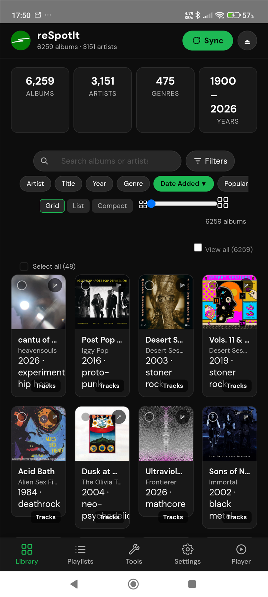

The default tab: your saved albums as a grid, with the server counters on top.

* Album / artist / genre / year counters and the year range.
* Search field, **Filters** button and the sort keys (artist, title, year,
  genre, date added, popularity).
* Grid / list / compact-grid switch and a grid-size slider.
* `6,259 albums` counter, **View all** toggle and **Select all visible**.
* Each card can be played on the device, queued, opened on Spotify, or opened in
  the track sheet.

## 2. Filters

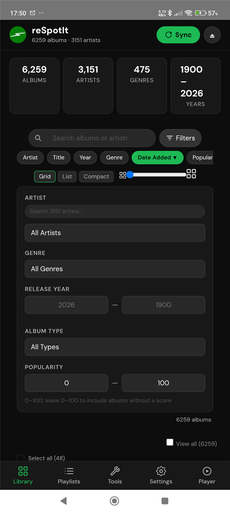

The filter panel: **artist**, **genre**, **release year** (from/to plus decade
shortcuts), **album type** and **popularity** (min/max). Results update
immediately.

## 3. Album track sheet

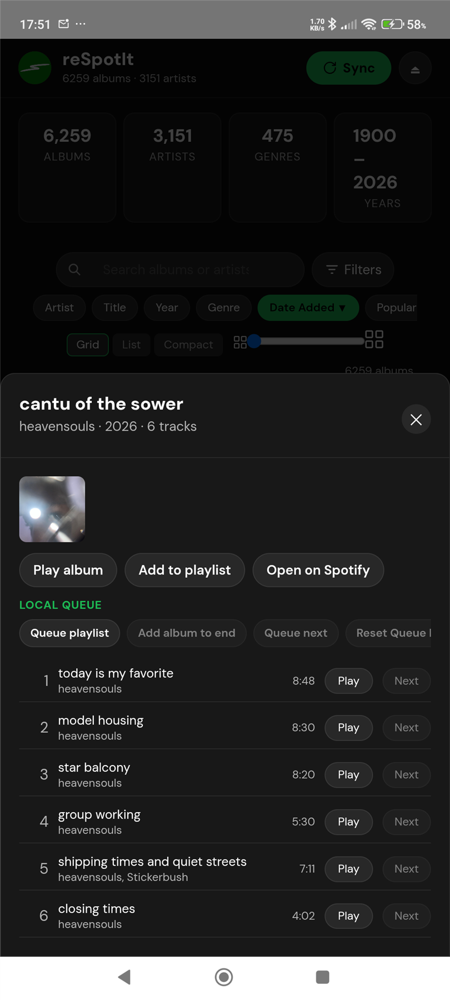

Sheet for one album with **Play album on Spotify**, **Add to playlist** and
**Open on Spotify**. When the sheet is opened from a playlist, it also shows
**Remove from playlist** at the top and **Remove** per track.

* **Play album on Spotify** hands the album to your **active Spotify device**
  (phone, speaker, TV — whatever you are listening on). It is *not* the
  browser player: the Web Playback SDK has its own tab.
* **Local queue**: queue playlist, add album to end, queue next, reset queue.
* Track list with title, artist, play time, and playlist position (when opened
  from a playlist). Each track shows a two-column action line:
  - **Local queue column** (on-device queue or local queue playlist): **Next** (queue
    next), **+** (add to end); in playlist context also **Pos** (play from
    playlist position, on-device only).
  - **Spotify column**: **Play** (play on your active Spotify device),
    **Next** (queue on Spotify); in playlist context also **Remove** (remove
    from playlist).
* The redundant per-track local **Play** button is removed in the album context
  (the playlist **Pos** button covers that intent for on-device playback).
* Above the track list a two-card legend explains both columns.

## 4. Playlists

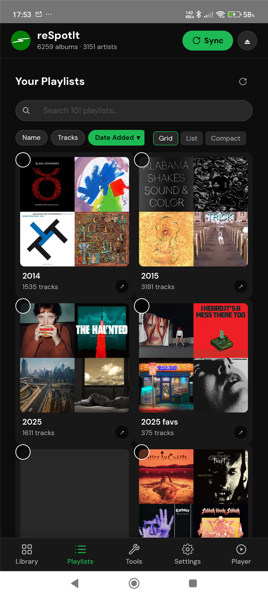

Your Spotify playlists as cards, with the search field, the **Name / Tracks /
Date Added** sort, the grid / list / compact switch and the **Date Added**
sort direction. Opening a playlist shows its albums with per-playlist filters,
CSV export and the retention (expiry) picker.

## 5. Tools

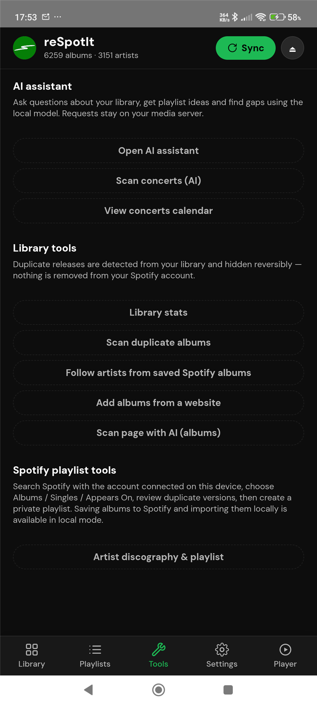

Everything that acts on your library:

| Button | What it does |
|---|---|
| **Open AI assistant** | Chat with the local model through your server (screen 16) |
| **Scan concerts (AI)** | AI concert scan of any page (screen 8) |
| **View concerts calendar** | Month calendar of saved concerts (screen 6) |
| **Library stats** | Album / artist / genre counters, top genres, top artists, albums by year |
| **Scan duplicate albums** | Duplicate review (screen 11) |
| **Follow artists from saved Spotify albums** | Follow every artist in your library |
| **Add albums from a website** | In-app browser that scrapes Spotify links (screen 13) |
| **Scan page with AI (albums)** | AI album scan of any page (screen 12) |
| **Artist discography & playlist** | Add an artist's releases to the library or a playlist |

## 6. Concerts calendar

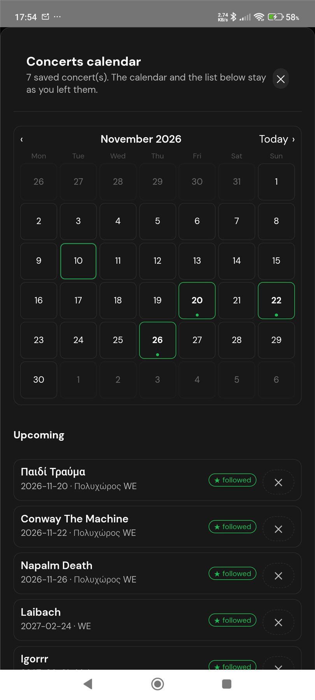

The saved concerts as a real calendar.

* Month grid (Monday-first) with ‹ / › navigation and a **Today** button.
* A day with concerts gets a green border and a dot; today is outlined.
* Below it, the concerts as **cards**: artist on the first line, date and venue
  on the second, a ★ badge for followed artists and a delete button.
* Sections: **Upcoming**, **Without a date** and **Past**.
* The month and the selected day survive closing and reopening the sheet.

## 7. A day selected

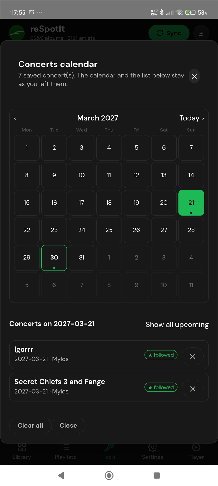

Tapping a day filters the list to that date ("Concerts on 2027-03-21") and
offers **Show all upcoming**.

## 8. Concert scan

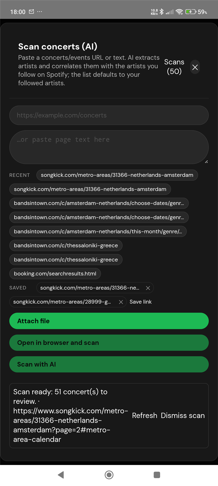

**Scan concerts (AI)**.

* Paste a concerts URL or text, attach a file, or pick a recent/saved link.
* **Open in browser and scan** loads the page in the in-app browser and
  snapshots the rendered DOM — the only way to read JS-built listings.
* The scan runs on the server in the background; the card at the bottom shows
  the progress and offers **Refresh** / **Dismiss scan**.
* Results arrive as cards you tick and save; the Followed/All switch filters by
  artists you follow on Spotify.

## 9. Library stats

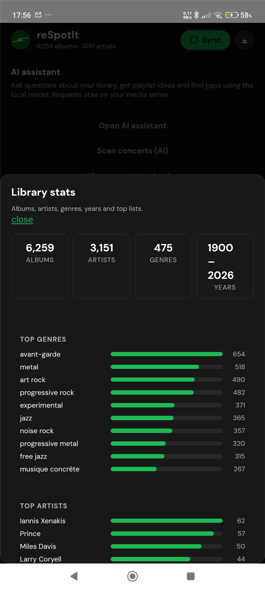

Totals (albums, artists, genres, years), the top genres with bars and the top
artists.

## 10. Stats breakdown

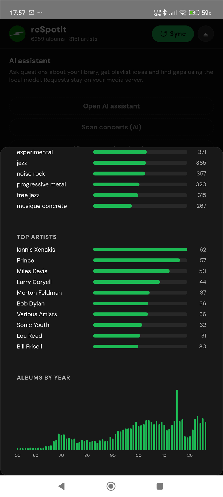

The same panel scrolled to the full **albums by year** histogram.

## 11. Duplicate albums

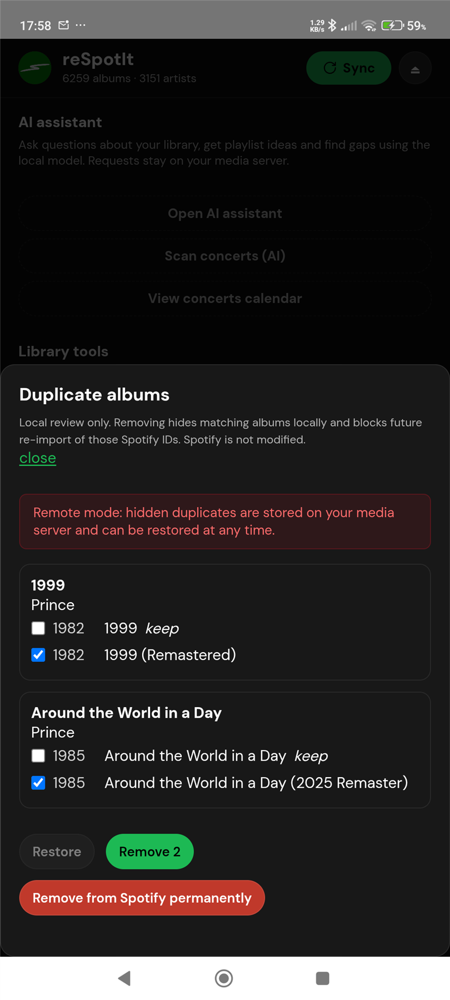

Duplicate review. Groups are matched by title and primary artist, ignoring
deluxe, remaster and regional tags. Uncheck the copy you want to keep — the
removal is stored on your media server and is reversible; Spotify is never
touched. The panel also explains the remote-mode behaviour (hidden duplicates
are stored on the server and can be restored at any time).

## 12. AI album scan

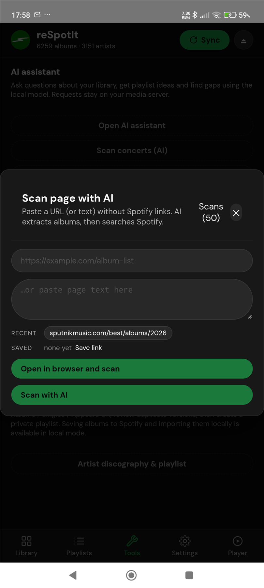

**Scan page with AI (albums)**.

* Paste a URL (or page text) of any chart or list — no Spotify links needed.
* **Open in browser and scan** loads the page in the app's own browser, then
  snapshots the rendered text and returns here with the URL preserved.
* The server chunks long pages, extracts `artist + album` pairs with the local
  LLM and resolves them against Spotify; the results can be saved to the
  library or turned into a playlist.
* The scan only **finds** the albums — nothing is saved until you press one of
  the buttons below.
* **Save N to Spotify & library** saves the ticked albums to **your Spotify
  library** first and then to the dashboard index, and says how many were
  saved.
* **Add to playlist (N)** puts them into a playlist you name in **New playlist
  name**, or into one of your existing playlists picked from the list.

## 13. Add from site

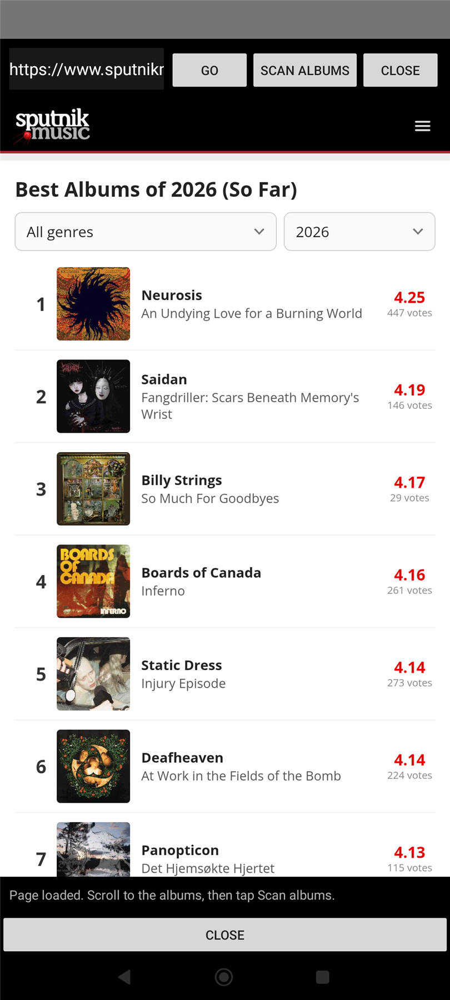

The in-app browser: URL bar with **GO**, **SCAN ALBUMS** and **CLOSE**, plus the
page-snapshot buttons (**Scan this page for concerts (AI)** / **Scan this page
for albums (AI)**). The scan evaluates `document.body.innerText` on the
*rendered* page, so pages that build their list with JavaScript work as well.

The detected albums are listed with checkboxes. **Save N to Spotify & library**
saves the ticked albums to **your Spotify library** and then to the dashboard
index; **Add to playlist (N)** puts them into a playlist you name, or into one
of your existing playlists.

## 14. Settings

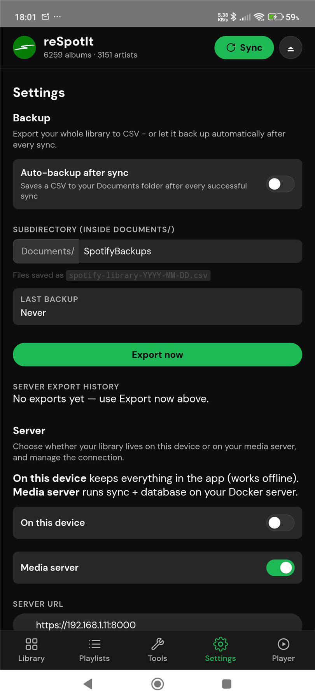

* **Backup** — export the whole library to CSV, auto-backup after every sync and
  the sub-folder to use.
* Grid size, sync photos, autohide the bottom navigation / the search & sort
  bar.
* CSV import and export, hidden (duplicate) albums, playlist retention.
* Media server (URL, sign-in, push/pull) and sign-out.

## 15. Player

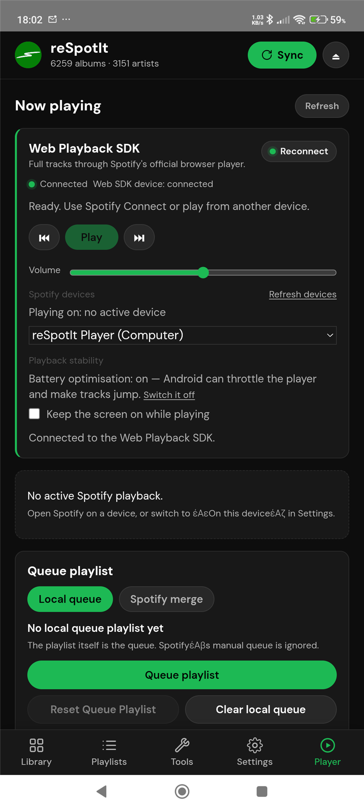

* **Web Playback SDK** — the official browser-based player: play/pause, volume,
  device picker and the playback-quality and keep-screen-on options.
* **Now playing** with a refresh; the active device is shown.
* **Queue playlist** with the local queue and Spotify merge modes, plus
  *Reset Queue Playlist* and *Clear local queue*.

## 16. AI assistant

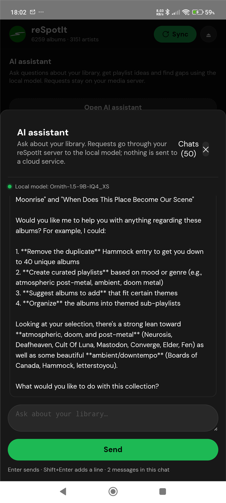

Chat with the local model through your media server. The assistant answers
questions about your library, suggests playlists and points out gaps. Requests
go through your server — nothing is sent to the app vendor. The chat history is
kept per user on the server.

---

## Related documents

* [`../README.md`](../README.md) — setup, build, architecture, CI, troubleshooting.
* `EXPERIMENTAL_FEATURES.md` in the server repo — the feature status of every
  AI-driven screen.
